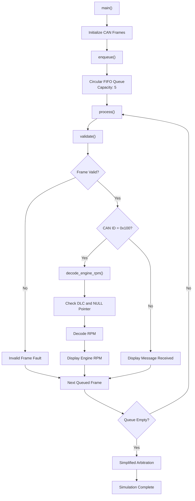

CANScope – System Architecture

1. Overview

CANScope simulates selected CAN communication concepts using C programming. It represents virtual ECUs, creates CAN frames, buffers messages, validates frames, and processes their payloads.

2. System Architecture

       VIRTUAL ECUs
   Engine | Speed | Temp
             |
             v
      CAN FRAME CREATION
             |
             v
      CIRCULAR FIFO QUEUE
             |
             v
       FRAME VALIDATION
        /          \
     Valid        Invalid
       |             |
       v             v
 MESSAGE          FAULT
 PROCESSING       DETECTION
       |
       v
   RPM DECODING
       |
       v
  SIMULATION OUTPUT

3. Main Components

CAN Frame Structure

The "CAN_Frame" structure represents a standard CAN frame using:

- "id": 11-bit standard identifier stored in a "uint16_t"
- "dlc": Data length code
- "data[8]": Payload storage

Circular FIFO Queue

The queue stores incoming CAN frames before processing.

- Capacity: 5 frames
- FIFO: First In, First Out
- Uses "front", "rear", and "count"
- Modulo operation manages circular indexing
- Detects queue overflow

Frame Validation

The "validate()" function checks:

- Standard CAN ID does not exceed "0x7FF"
- DLC does not exceed 8

Message Processing

The "process()" function:

1. Retrieves the next queued frame.
2. Validates the frame.
3. Identifies the message using its CAN ID.
4. Decodes engine RPM when the ID is "0x100".
5. Reports invalid or insufficient payload data.

Engine RPM Decoding

The "decode_engine_rpm()" function combines two payload bytes using bitwise operations.

Example:

RPM = (data[0] << 8) | data[1];

For payload bytes "0x0B" and "0xB8", the decoded value is 3000.

Simplified Arbitration

The "arbitrate()" function compares two standard CAN IDs numerically and returns the lower ID.

In standard CAN arbitration, a lower numerical identifier has higher priority. This project demonstrates that priority rule without implementing bit-level bus arbitration.

4. Software Execution Flow

1. Initialize virtual ECU messages.
2. Insert frames into the circular queue.
3. Retrieve frames in FIFO order.
4. Validate each frame.
5. Decode supported payloads.
6. Display processing results.
7. Demonstrate arbitration priority.

5. Implementation Limitations

This project is a software concept simulator. It does not implement:

- Physical CAN controller or transceiver
- Actual CAN bus communication
- Bit timing and synchronization
- CRC and ACK fields
- Error frames and error counters
- Bit-by-bit arbitration

6. Future Improvements

- Add more ECU message decoders.
- Implement configurable message filtering.
- Add simulated bus-load analysis.
- Improve arbitration simulation with bit-level identifier comparison.


## 7. Architecture Diagram

The following diagram illustrates the CANScope message-processing workflow.



## 8. Circular Queue Design

CANScope uses a circular FIFO queue with a maximum capacity of five CAN frames.

| Variable | Purpose |
|---|---|
| front | Index of the next frame to process |
| rear | Index of the latest inserted frame |
| count | Number of frames currently stored |
| SIZE | Maximum queue capacity |

Circular indexing:

```c
rear = (rear + 1) % SIZE;
front = (front + 1) % SIZE;
```

The modulo operator allows the queue indices to wrap around to the beginning of the array.

